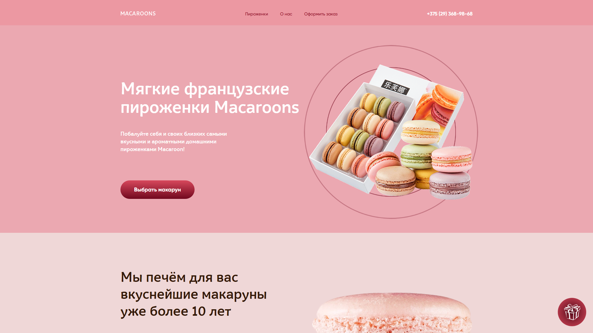
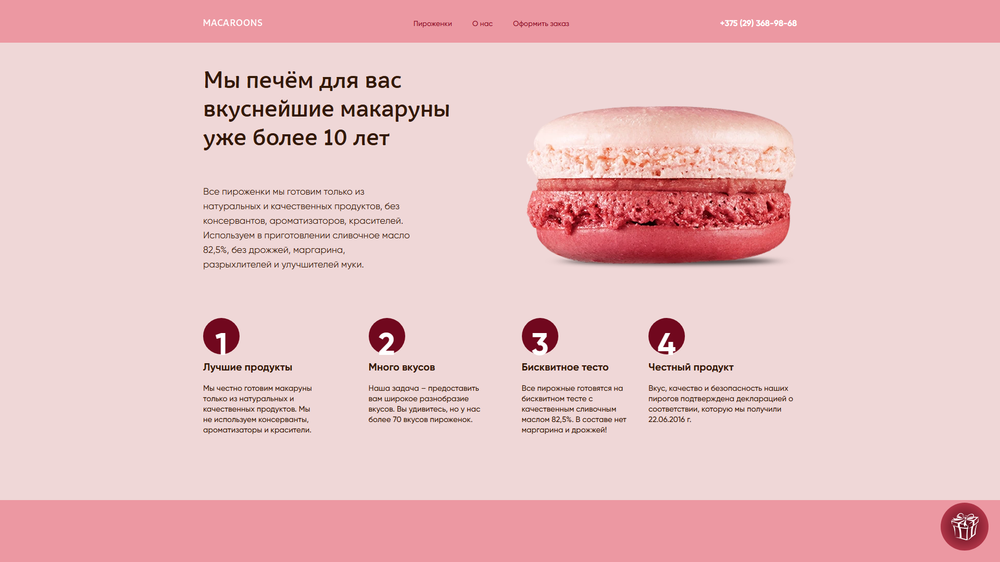
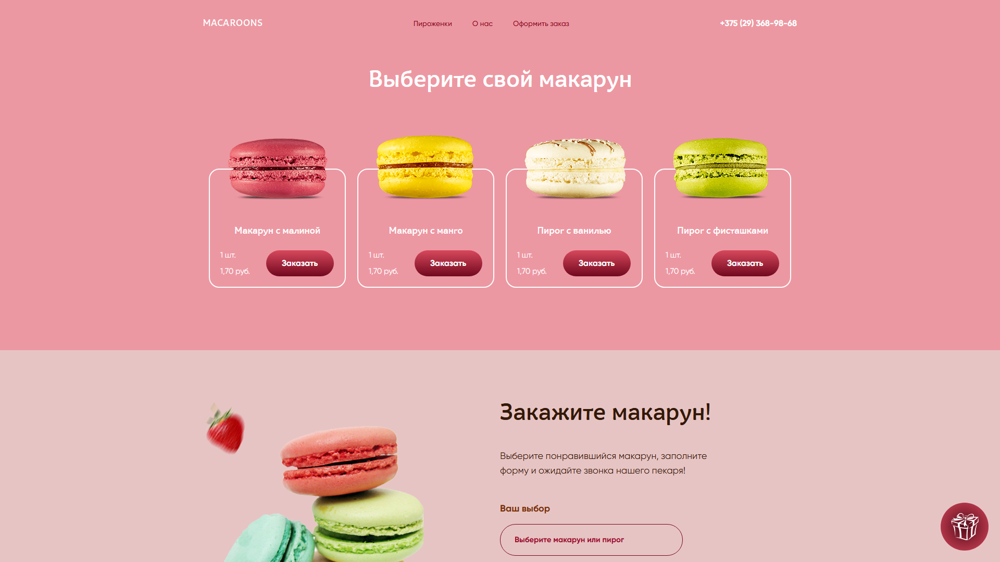
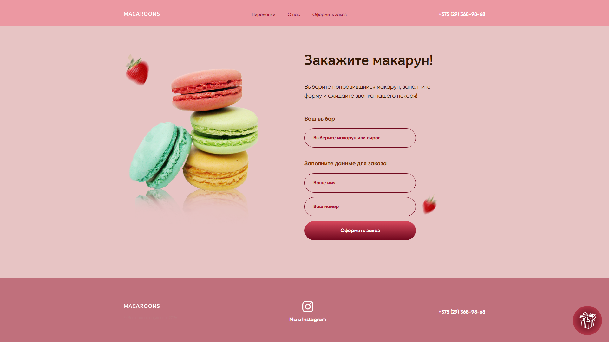
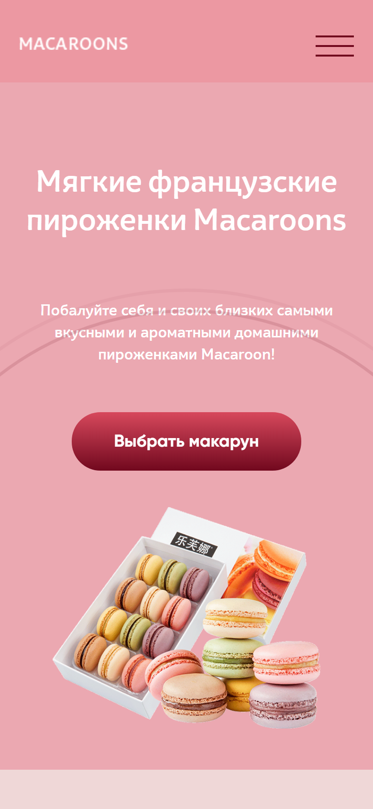

<h1 align="center">MacaroonsShop</h1>

<p align="center">
  <b>Лендинг кондитерской с макарунами: каталог, подстановка выбранного товара в заказ и отправка формы.</b>
</p>

<p align="center">
  
  
  
  
  <a href="https://dekciw.github.io/MacaroonsShop/"></a>
</p>

<p align="center">
  <a href="https://dekciw.github.io/MacaroonsShop/">
    
  </a>
</p>

<br>

<p align="center">
  
</p>

<br>

<table align="center">
  <tr>
    <th>&#8199;&#8199;&#8199;&#8199;&#8199;&#8199;Разделы&#8199;&#8199;&#8199;&#8199;&#8199;&#8199;</th>
    <th>&#8199;&#8199;&#8199;&#8199;&#8199;&#8199;Заказ&#8199;&#8199;&#8199;&#8199;&#8199;&#8199;</th>
    <th>&#8199;&#8199;&#8199;&#8199;&#8199;&#8199;Вёрстка&#8199;&#8199;&#8199;&#8199;&#8199;&#8199;</th>
  </tr>
  <tr>
    <td valign="top">
      - Первый экран<br>
      - О кондитерской<br>
      - Четыре преимущества<br>
      - Каталог из 4 товаров<br>
      - Форма заказа<br>
      - Подвал с контактами
    </td>
    <td valign="top">
      - Товар подставляется сам<br>
      - Плавная прокрутка к форме<br>
      - В телефон только цифры<br>
      - Проверка пустых полей<br>
      - Анимация загрузки<br>
      - Отправка на тестовый сервер
    </td>
    <td valign="top">
      - Адаптив до 320 px<br>
      - Мобильное меню<br>
      - Стили на Less<br>
      - Сборка через Gulp и Grunt<br>
      - jQuery<br>
      - Сайт на GitHub Pages
    </td>
  </tr>
</table>

<h3 align="center">Как это выглядит</h3>

<table align="center">
  <tr>
    <td width="50%" align="center" valign="top">
      <br>
      <sub>О кондитерской</sub>
    </td>
    <td width="50%" align="center" valign="top">
      <br>
      <sub>Каталог</sub>
    </td>
  </tr>
  <tr>
    <td width="50%" align="center" valign="top">
      <br>
      <sub>Заказ</sub>
    </td>
    <td width="50%" align="center" valign="top">
      <br>
      <sub>Мобильная версия</sub>
    </td>
  </tr>
</table>

<br>

<details>
<summary><b>Подробнее о проекте: стек, устройство, запуск</b> (нажми, чтобы развернуть)</summary>

<br>

### Стек

<p>
- <b>Вёрстка:</b> HTML и Less<br>
- <b>Сборка стилей:</b> Gulp и Grunt, практика сборки Less в CSS<br>
- <b>Скрипты:</b> jQuery 3.7, подключается из CDN
</p>

### Структура

```
.
├── index.html          # вся страница
├── index.js            # меню, подстановка товара, проверка и отправка формы
├── src/styles/         # исходники Less
├── dist/css/style.css  # готовые стили, которые подключает страница
├── gulpfile.js         # сборка Less через Gulp
├── gruntfile.js        # сборка Less через Grunt
├── assets/             # картинки, иконки и шрифты
└── screenshots/        # скриншоты для README
```

### Как работает заказ

Кнопка «Заказать» у товара записывает его название в форму и плавно прокручивает страницу к ней. Если поле пустое, под ним появляется подсказка. Заполненная форма отправляется на учебный сервер `testologia.ru`, пока идёт запрос, крутится анимация загрузки.

### Запуск

Сборка не нужна: откройте `index.html` в браузере, готовый CSS уже лежит в `dist/css/style.css`.

Исходники стилей лежат в `src/styles/`. Настройки Gulp и Grunt остались с учебной практики и пишут результат в другие папки, поэтому страница использует уже собранный файл.

</details>
